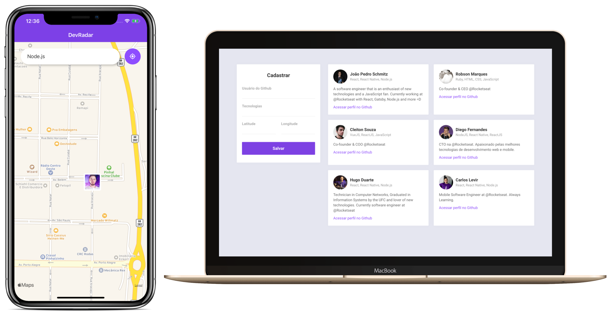

> **Projeto de estudo.** Estado conferido em 31/10/2026: os endereços que seguem fora do ar foram retirados deste README. Detalhes em [docs/AVALIACAO.md](docs/AVALIACAO.md) e próximos passos em [docs/PLANO-ESTRATEGICO.md](docs/PLANO-ESTRATEGICO.md).

<h4 align="center">
  🚀 Dev Radar
</h4>

<p align="center">
  
</p>

<h1 align="center">
    
</h1>

<p align="center">
  

  
  
  <a href="https://github.com/Rocketseat/semana-omnistack-10/commits/master">
    
  </a>

  <a href="https://github.com/Rocketseat/semana-omnistack-10/issues">
    
  </a>

  
</p>

<p align="center">
  <a href="#rocket-tecnologias">Tecnologias</a>&nbsp;&nbsp;&nbsp;|&nbsp;&nbsp;&nbsp;
  <a href="#-projeto">Projeto</a>&nbsp;&nbsp;&nbsp;|&nbsp;&nbsp;&nbsp;
  <a href="#-layout">Layout</a>&nbsp;&nbsp;&nbsp;|&nbsp;&nbsp;&nbsp;
  <a href="#-como-contribuir">Como contribuir</a>&nbsp;&nbsp;&nbsp;|&nbsp;&nbsp;&nbsp;
  <a href="#memo-licença">Licença</a>
</p>

## 🧠 O que aprendi

> Proposta de 01/11/2026, escrita a partir do código e das dependências. Ajuste com a sua experiência.

- Integrar API, web React e app Expo.

App móvel: Expo 43, React Native 0.64. O CI instala com `legacy-peer-deps` e roda os testes; não empacota o app.

- Buscar registros por localização, usando Mongoose e mapas no celular.
- Atualizar telas em tempo real com Socket.IO.
- Validar entradas da API com Zod.

### 💻 Projeto

Construir o app inspirado no waze para localizar desenvolvedores na sua região.  
O Dev Radar é uma aplicação que segue alguns parâmetros para localizar desenvolvedores e assim conectar profissionais as demandas conforme os projetos. 💰

## ▶️ Como executar

Pré-requisitos: Node.js 20 e um cluster gratuito no MongoDB Atlas.

```bash
# API (porta 3333)
cd backend
cp .env.example .env      # preencha MONGODB_URI
npm install
npm run dev               # ou npm start · npm test (8 testes)

# Web (porta 3000)
cd ../web
npm install
npm start                 # VITE_API_URL aponta para a API (padrão http://localhost:3333)

# Mobile
cd ../mobile
npm install
# em app.json, troque expo.extra.apiUrl pelo IP da sua máquina na rede (ex.: http://192.168.0.10:3333)
npx expo start
```

### Contrato da API

| Método | Rota | Descrição |
|---|---|---|
| GET | `/devs` | Lista os devs |
| POST | `/devs` | Cadastra pelo GitHub (`github_username`, `techs`, `latitude`, `longitude`) |
| PUT | `/devs/:github_username` | Atualiza tecnologias e/ou posição |
| DELETE | `/devs/:github_username` | Remove do radar |
| GET | `/search?latitude&longitude&techs` | Devs com as tecnologias num raio de 10 km |

Tempo real (Socket.IO): conecte com `latitude`, `longitude` e `techs` na query e ouça `new-dev`.

### ☁️ Hospedagem gratuita

**Demonstração:** Fora do ar desde a conferência de 31/10/2026; para ver o projeto, rode localmente (seção "Como executar").

API no Render (web service free, com WebSocket) + MongoDB Atlas M0; web no Render como site estático com `VITE_API_URL`. Os dois sobem juntos pelo `render.yaml` (branch `master`). A API dorme após 15 min sem acesso (~1 min para acordar). O app mobile (Expo SDK 43) fica fora do deploy até a atualização do SDK. Passo a passo completo: [docs/DEPLOY.md](docs/DEPLOY.md).

## 📊 Estado do MVP & Documentação

| Documento | Conteúdo |
|---|---|
| [docs/ANALISE.md](./docs/ANALISE.md) | Requisitos, diagnóstico, rubrica e notas |
| [docs/ARQUITETURA.md](./docs/ARQUITETURA.md) | C4, modelo geoespacial, contrato e ADRs |
| [docs/PLANO-DE-ACAO.md](./docs/PLANO-DE-ACAO.md) | Tarefas priorizadas por MoSCoW |

| Momento | Nota MVP | Situação |
|---|---|---|
| Antes (27/09/2026) | 3,10 | Reprovado — credenciais do banco no código, tempo real quebrado e app móvel sem compilar |
| Depois (27/09/2026) | 7,68 | Aprovado — falta trocar a senha do Atlas e validar o app num aparelho |

## :rocket: Tecnologias

Esse projeto foi desenvolvido com as seguintes tecnologias:

- HTML/CSS/Javascript
- ReactJS
- React Native
- Nodejs
- MongoDB
- Git/Github
- Yarn/Npm 

### 🚀 Ferramentas

- VSCode
- Git Bash
- Insomnia
- MongoDB Atlas
- MongoDB Compass

### 🔖 Layout

Você pode visualizar o layout do projeto através [desse link](https://www.figma.com/file).
É necessário ter conta no [Figma](https://figma.com) para acessá-lo.

## Configurar Ambiente

- nodejs
- chocolatey 
- npm
- yarn
- vscode
- extensões vscode: drácula e material icon theme

## Qual a proposta deste projeto - parte 1? Criando a base da aplicação 

- [x] backend com Nodejs 
- [x] regras de negócio 
- [x] conexão com banco de dados
- [x] envio de e-mail
- [x] comunicação com webservices
- [x] autenticação do usuário 
- [x] criptografia e segurança
- [x] Json a estrutura de dados para interligar o backend com o frontend 
- [x] `yarn init -y` : na pasta C:\douglasabnovato\rocketseat\omnistack-10\backend
- [x] `package.json` : arquivo de configuração
- [x] `yarn add express` : auxilia na criação de rotas
- [x] `node index.js`: executa nosso servidor
- [x] `npm init -y`: vou usar npm
- [x] `npm install nodemon - D`: restartar o servidor
- [x] Ferramenta Insomnia: configurar rest
- [x] Listar Usuários - GET: criar nova requisição
- [x] Métodos HTTP: get, post, put, delete
- [x] Tipos de parâmetros: query params (request.query: filtros, ordenação, paginação, ...), 
- [x] Tipos de parâmetros: route params (request.params: identificar um recurso na alteração ou remoção)
- [x] Tipos de parâmetros: body (dados para a criação ou alteração de um registro)
- [x] conectar com o bd - mongodb - não relacional - hospedagem na núvem com mongodb atlas 
- [x] Instalar o Mongoose: `npm install mongoose` 
- [x] Arquivos de rotas: `routes.js`
- [x] Biblioteca axios faz chamadas para outras API: `npm install axios`
- [x] MongoDB Compass: SGBD que permite visualizar o bd
- [x] DevController: index, show, store, update, destroy
- [x] SearchController
- [x] Iniciar o projeto backend: `npm run dev`
 
## Qual a proposta deste projeto - parte 2? Construindo a interface web 

- [x] Introdução do cenário de desenvolvimento: abordagem com framework e abordagem com js, html, css
- [x] Criar projeto: `npx create-react-app web`
- [x] Iniciar o projeto frontend web: `npm start`
- [x] Criado a estrutura dos elementos no App
- [x] Estilização do global.css
- [x] Estilização do Sidebar.css
- [x] Estilização do Main.css
- [x] Aplicar responsividade: quando aplicar, como aplicar
- [x] Função de Geolocalização
- [x] Instalação e configuração de extensão no backend: `cors`. Objetivo de permitir acessar o backend
- [x] Axios: `npm install axios` 
- [x] map para exibir a lista de devs
- [x] refatoração e estrutura de pastas
- [x] warning: não está adicionando dev: revisar o web: key no li para montar no frontend.
- [x] warning: não está adicionando dev: revisar o backend: e.preventDefault escrito errada.

## Qual a proposta deste projeto - parte 3? Desenvolvendo o app mobile 

- [x] Aplicação será construída com react native com expo
- [x] Instalar expo: `npm install -g expo-cli`
- [x] Criar o módulo: `expo init mobile --template blank`
- [x] Iniciar o projeto mobile: `npm start` 
- [x] `localhost:19002` e o abrir o qr com o app expo instalado.
- [x] alterando a versão do node para corrigir o warning
- [x] warnings e errors: [docs!](https://github.com/Rocketseat/expo-common-issues)
- [x] [docs expo](https://docs.expo.dev/)
- [x] MapsView: `expo install react-native-maps`
- [x] location: `expo install expo-location`
- [x] WebView: `expo install react-native-webview`

## Qual a proposta deste projeto - parte 4? Funcionalidades Avançadas 

- [x] no backend: Adicionar dependência da socket.io: `npm install socket.io`
- [x] no backend: Configuração do socket.io
- [x] no mobile: Adicionar dependência da socketio: `npm install socket.io-client`  
- [x] no mobile: Configuração do socket.io na página main, na função loadDevs

## :memo: Licença

Esse projeto está sob a licença MIT. Veja o arquivo [LICENSE](.github/LICENSE.md) para mais detalhes.

---

Feito com ♥ by [douglasabnovato!](https://www.linkedin.com/in/douglasabnovato/) :wave: 

Fonte do projeto: [Diego Fernandes - Rocketseat - Semana Omnistack 10.0 - dev radar](https://www.rocketseat.com.br/)
