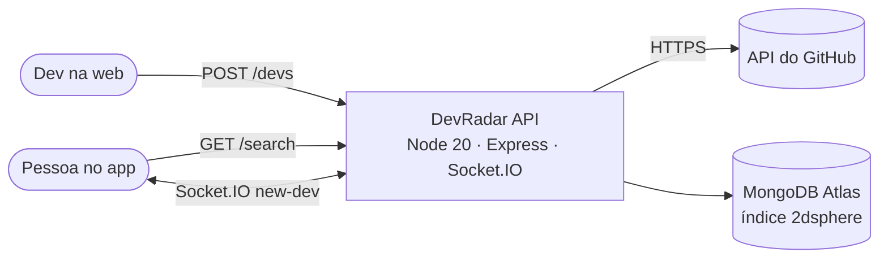
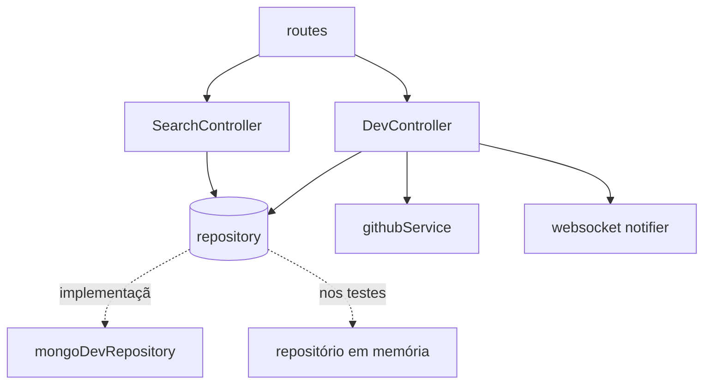

# Arquitetura — DevRadar

## 1. Visão C4

| Contêiner | Pasta | Tecnologia | Hospedagem gratuita |
|---|---|---|---|
| API + WebSocket | `backend/` | Node 20, Express 4, Socket.IO 4, Mongoose 6, zod | Render (web service free; suporta WebSocket) |
| Web | `web/` | React 18, CRA 5 | Vercel ou GitHub Pages |
| Mobile | `mobile/` | Expo, React Native, react-native-maps | Expo Go (desenvolvimento) |
| Banco | — | MongoDB Atlas M0 (512 MB grátis) | Atlas |

## 2. Componentes da API (inversão de dependência)

`createApp({ repository, github, notifier })` recebe as dependências; os testes usam fakes em memória porque o ambiente de CI não baixa o binário do MongoDB.

## 3. Modelo de dados (documento `devs`)

| Campo | Tipo | Regra |
|---|---|---|
| `github_username` | string | único, minúsculo |
| `name`, `avatar_url`, `bio` | string | vindos do GitHub |
| `techs` | string[] | minúsculas, sem duplicatas; índice |
| `location` | GeoJSON Point | `[longitude, latitude]`; índice `2dsphere` |
| `createdAt`, `updatedAt` | date | `timestamps` |

A busca usa `$near` com `$maxDistance` (metros) sobre o índice 2dsphere: os resultados já vêm ordenados por distância, sem calcular distância para todos os documentos.

## 4. Contrato REST e tempo real

| Método | Rota | Entrada | Saída |
|---|---|---|---|
| GET | `/health` | — | `{status}` |
| GET | `/devs` | — | `Dev[]` (até 200, mais recentes) |
| POST | `/devs` | `github_username`, `techs`, `latitude`, `longitude` | `201 Dev` novo · `200 Dev` já existente · `400` · `404` GitHub · `503` GitHub fora |
| PUT | `/devs/:github_username` | `techs?`, `latitude?` + `longitude?` | `200 Dev` · `404` |
| DELETE | `/devs/:github_username` | — | `204` · `404` |
| GET | `/search` | `latitude`, `longitude`, `techs` | `{ devs }` num raio de 10 km |

Socket.IO: o cliente conecta com `query = { latitude, longitude, techs }`; recebe `new-dev` quando alguém a menos de 10 km cadastra uma tecnologia buscada.

## 5. Decisões (ADR)

### ADR-001 — Credenciais só por ambiente
- `MONGODB_URI` obrigatório; a API não sobe sem ele. A senha antiga precisa ser trocada no Atlas porque está no histórico.

### ADR-002 — Repositório injetável
- Permite testar regras e HTTP sem MongoDB e trocar o banco no futuro.

### ADR-003 — Tecnologias em minúsculas
- Garante que "React" e "react" se encontrem no `$in`. Consequência: a lista aparece em minúsculas.

### ADR-004 — POST idempotente
- Cadastro repetido devolve 200 com o registro atual; o índice único fecha a corrida entre duas requisições.

### ADR-005 — Mobile corrigido sem atualizar o SDK
- Os erros de código foram corrigidos, mas o Expo SDK 43 não é mais aceito pelo Expo Go atual. Atualizar o SDK (e trocar `react-navigation` 4 pelo 6) é o próximo passo e fica fora deste ciclo.

## 6. Fora do escopo
- Autenticação (hoje qualquer pessoa pode editar/remover um cadastro pelo nome de usuário — aceitável no MVP de portfólio, mas precisa de login com GitHub OAuth antes de uso real).
- Atualização do Expo SDK e testes do mobile.
