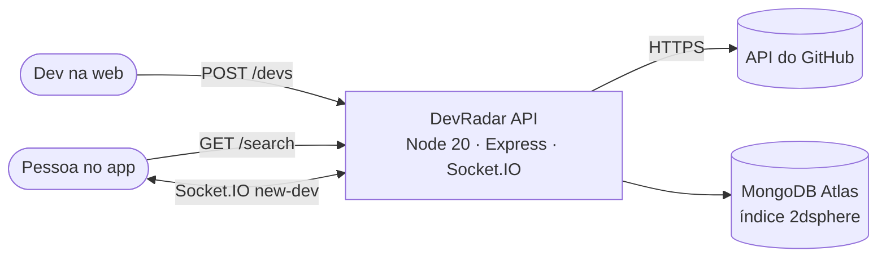
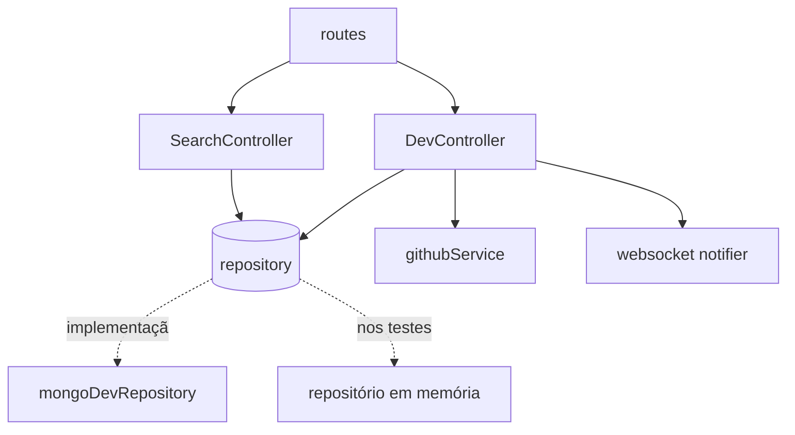

# Arquitetura — DevRadar

## 1. Visão C4

| Contêiner | Pasta | Tecnologia | Hospedagem gratuita |
|---|---|---|---|
| API + WebSocket | `backend/` | Node 20, Express 4, Socket.IO 4, Mongoose 6, zod | Render (web service free; suporta WebSocket) |
| Web | `web/` | React 18, Vite 8 | Vercel ou GitHub Pages |
| Mobile | `mobile/` | Expo, React Native, react-native-maps | Expo Go (desenvolvimento) |
| Banco | — | MongoDB Atlas M0 (512 MB grátis) | Atlas |

## 2. Componentes da API (inversão de dependência)

`createApp({ repository, github, notifier })` recebe as dependências; os testes usam fakes em memória porque o ambiente de CI não baixa o binário do MongoDB.

## 3. Modelo de dados (documento `devs`)

| Campo | Tipo | Regra |
|---|---|---|
| `github_username` | string | único, minúsculo |
| `name`, `avatar_url`, `bio` | string | vindos do GitHub |
| `techs` | string[] | minúsculas, sem duplicatas; índice |
| `location` | GeoJSON Point | `[longitude, latitude]`; índice `2dsphere` |
| `createdAt`, `updatedAt` | date | `timestamps` |

A busca usa `$near` com `$maxDistance` (metros) sobre o índice 2dsphere: os resultados já vêm ordenados por distância, sem calcular distância para todos os documentos.

## 4. Contrato REST e tempo real

| Método | Rota | Entrada | Saída |
|---|---|---|---|
| GET | `/health` | — | `{status}` |
| GET | `/devs` | — | `Dev[]` (até 200, mais recentes) |
| POST | `/devs` | `github_username`, `techs`, `latitude`, `longitude` | `201 Dev` novo · `200 Dev` já existente · `400` · `404` GitHub · `503` GitHub fora |
| PUT | `/devs/:github_username` | `techs?`, `latitude?` + `longitude?` | `200 Dev` · `404` |
| DELETE | `/devs/:github_username` | — | `204` · `404` |
| GET | `/search` | `latitude`, `longitude`, `techs` | `{ devs }` num raio de 10 km |

Socket.IO: o cliente conecta com `query = { latitude, longitude, techs }`; recebe `new-dev` quando alguém a menos de 10 km cadastra uma tecnologia buscada.

## 5. Decisões (ADR)

### ADR-001 — Credenciais só por ambiente
- `MONGODB_URI` obrigatório; a API não sobe sem ele. A senha antiga precisa ser trocada no Atlas porque está no histórico.

### ADR-002 — Repositório injetável
- Permite testar regras e HTTP sem MongoDB e trocar o banco no futuro.

### ADR-003 — Tecnologias em minúsculas
- Garante que "React" e "react" se encontrem no `$in`. Consequência: a lista aparece em minúsculas.

### ADR-004 — POST idempotente
- Cadastro repetido devolve 200 com o registro atual; o índice único fecha a corrida entre duas requisições.

### ADR-005 — Mobile corrigido sem atualizar o SDK (superada em 09/11/2026)
- Em 09/11/2026 o app foi migrado do Expo SDK 43 para o 57, com React Navigation 7 no lugar do `react-navigation` 4 (#63). Falta abrir as telas num aparelho (#69).

### ADR-006 — Aceitar os alertas de desenvolvimento do Dependabot
- **Status:** Aceita. **Data:** 16/11/2026.
- **Contexto:** em 16/11/2026, às 14h39, `gh api "repos/douglasabnovato/dev-radar/dependabot/alerts?state=open&per_page=100"` devolveu 3 alertas, todos em `mobile/package-lock.json`. API e web não têm alerta. Regra para os alertas, ordem do responsável repassada pelo DG líder em 16/11/2026: "Regra geral por ADR. alertas que nao atrapalham a producao, pode passar. os que atrapalham, entender, escolher a melhor estrategia para manter a funcionalidade". "Produção" é a API e a web publicadas e o JavaScript que o Metro empacota no app (estudo N1, roda no Expo Go, sem build em loja).
- **Decisão:**

| Alerta | Pacote | Severidade | Quem o puxa | Por que não chega à produção |
|---|---|---|---|---|
| #621 | `minimatch` 10.2.6 (GHSA-g3hv-75wg-m249) | média | `expo` → `@expo/fingerprint` 0.20.16 | Ferramenta de build e da CLI do Expo; fora do bundle. A correção só existe na versão 11, que o Expo 57 não aceita. |
| #613 | `deepmerge` 4.3.1 (GHSA-gcqx-w48m-w2h4) | baixa | `jest` → `@jest/core` → `jest-config` | Só roda nos testes, em dependência de desenvolvimento. Sem versão corrigida publicada. |
| #620 | `glob` (GHSA-3g3m-2fjr-6pw4) | média | CLI e config do Expo | Fora desta ADR: corrigido na sprint-19 (PR #81, `glob` 14.0.4); fecha no merge na `master`. |

- **Prova** (16/11/2026, `mobile/` no clone da `developer/sprint-2026-11-19`, depois de `npm ci`): `npm ls minimatch deepmerge glob --all` mostra `minimatch@10.2.6` só sob `@expo/fingerprint`, `deepmerge@4.3.1` só sob `jest-config` e todo `glob` 9 a 14 em 14.0.4. `npx expo export --platform android --source-maps`: 960 módulos no mapa de fontes, 0 de `minimatch`, `glob`, `deepmerge`, `@expo/fingerprint` ou `jest`; o único arquivo de `@expo/cli` é o carregador de módulos do Metro (`metro-require/require.js`). `npm audit --omit=dev`: 3 moderados, todos na cadeia `expo` → `@expo/fingerprint` → `minimatch`. Nenhum alerta foi fechado ou dispensado pela API.
- **Consequências:** o risco fica no ambiente de quem desenvolve e no CI (CLI do Expo e testes), não no site, na API nem no app empacotado. Os alertas #621 e #613 seguem abertos no GitHub e contam como cobertos no critério 9 do `docs/MVP.md`. De 23/10 a 26/11/2026, 12 runs de atualização do Dependabot falharam na `master` com `security_update_not_possible`. O workflow `CI` ficou em 21 de 21 verdes no mesmo período (#91).
  - 6 runs, de 01/11, eram de alertas que a migração para o Expo 57 corrigiu em 16/11: `image-size` #557 e `decode-uri-component` #533 e #585.
  - 1 run, de 01/11, era do `minimatch` 3.1.5 da `web`, que não tem alerta aberto hoje.
  - 5 runs, de 01 e 16/11, são do `minimatch` 10.2.6 do app, o #621. Em 16/11, a única saída seria baixar o `expo` de 57.0.32 para 52.0.49.
  - Esses runs não medem o CI e não pedem correção no código.
- **Quando revisar:** se `minimatch`, `deepmerge` ou `@expo/fingerprint` aparecerem no mapa de fontes do `npx expo export`; se sair correção sem versão maior dentro do Expo 57; na migração para o Expo SDK 58.

## 6. Fora do escopo
- Autenticação (hoje qualquer pessoa pode editar/remover um cadastro pelo nome de usuário — aceitável no MVP de portfólio, mas precisa de login com GitHub OAuth antes de uso real).
- Atualização do Expo SDK. Os testes da tela do mapa do app entraram em 26/11/2026 (#85 e #100); o app num aparelho segue na #69.
